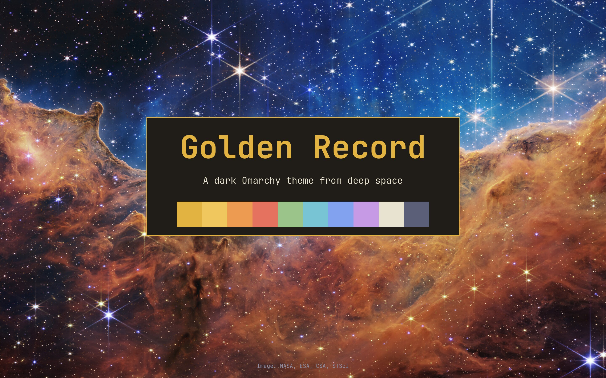

# Golden Record

A dark [Omarchy](https://omarchy.org) theme from deep space: blue-black backgrounds, warm starlight text and gold accents, named after the golden records that Voyager 1 and 2 carry out of the solar system.



## Install

```bash
omarchy theme install https://github.com/PavlikPolivka/golden-record
```

or Super + Alt + Space → Install → Style → Theme, and paste the link.

## What's included

- **Colours** (`colors.toml`): Omarchy generates the terminal, editor, bar, btop, browser and other app themes from these.

  | Role | Colour |
  |---|---|
  | Background | `#0b0d14` |
  | Text | `#e8e2d0` |
  | Accent (gold) | `#e3b341` |
  | Selection | `#2b2f42` |
  | Window border | gold gradient `#e3b341` → `#f7d98a` |

- **Icons:** Yaru-yellow.
- **Seven 4K backgrounds** from NASA missions (Super + Ctrl + Space to switch):
  Webb's Cosmic Cliffs, Webb's First Deep Field, Saturn eclipsing the Sun (Cassini), Webb's Tarantula Nebula, Earthrise (Apollo 8), the Sun in extreme ultraviolet (SDO) and Webb's Cartwheel Galaxy.

## Optional: rotating background

To show the next background every 20 minutes while Golden Record is the active theme, run once:

```bash
bash ~/.config/omarchy/themes/golden-record/extras/install-rotation.sh
```

It installs a small user timer (`golden-record-rotate.timer`) that does nothing while another theme is active. Change the interval in `~/.config/systemd/user/golden-record-rotate.timer`. Remove it with `extras/uninstall-rotation.sh`.

## Credits and licences

The theme files are under the MIT licence (`LICENSE`). The backgrounds are NASA and Webb images, cropped and resized to 3840×2160; see `CREDITS.md` for each image's source and licence.
